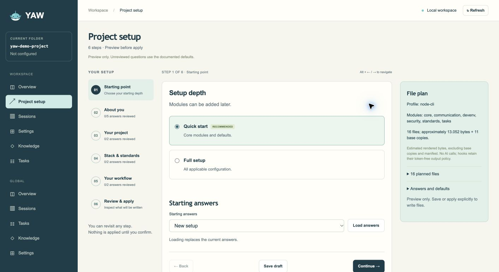

<div align="center">
  

  # YAW

  **Give your coding agents a project they can pick up and understand.**

  YAW sets up shared instructions, repeatable project commands, tasks and optional project memory for Claude Code, Codex and Copilot CLI. It writes ordinary files you can review and edit, then gives you a local dashboard to see the work across sessions.

  [Set up a project](#set-up-once) · [See what it does](#what-you-get) · [Website](website/) · [Full guide](docs/getting-started.md)
</div>

## Why use YAW?

A new agent session should not have to rediscover how to run your project, which tasks matter, or why a decision was made. YAW puts that context in the repository and connects it to the tools you already use. You can start with a small setup and add workflows only when they help.

- **Less repeated setup:** one interview creates shared `AGENTS.md` instructions, selected agent adapters and project-specific `just` commands.
- **A clear next step:** plan an idea with `yaw kickoff`, turn the plan into tasks, and resume from local tasks or GitHub issues.
- **Decisions that survive sessions:** record and retrieve decisions, risks and knowledge instead of relying on a past chat.
- **Visibility across workspaces:** the local dashboard shows projects, sessions, tasks and knowledge, with filters and session profiling when you explicitly collect it.
- **Control of your files:** preview changes before applying them. YAW keeps your edits to managed files during later updates unless you choose otherwise.

YAW is a zero-runtime-dependency Node.js CLI. It runs locally on macOS and Linux, or on Windows through WSL.

## Set up once

Requires **Node.js 22.13+** and **Git**. [`just`](https://just.systems) is recommended for generated project commands.

```sh
curl -fsSL https://raw.githubusercontent.com/nickyreinert/yaw/main/install.sh | bash -s -- --channel main
cd your-project
yaw init
```

This installs the current `main` channel, which includes the features described here. The [full guide](docs/getting-started.md) has the pinned v0.1.0 release install if you prefer a fixed version.

`yaw init` asks which language you want to use and where the project will run; that pair picks a tailored stack (for example a Node CLI or a Cloudflare Worker) or a basic one for the language. Choose **Quick**, **Basic** or **All** interview depth first. Review the proposed files before YAW writes them. Prefer a browser form? Run `yaw init --web`, or switch to it during the terminal interview. Setup normally runs the generated `just setup` and `just check` afterward.

Quick asks agents, purpose, language, runtime and GitHub. Basic adds personal preferences, collaboration and review gates; All asks every applicable question. Optional tools reuse your saved defaults and otherwise start off. Select tasks, guards, sessions, decisions, hooks and other modules explicitly when needed. A fresh interactive installation offers personal defaults, and `yaw defaults` edits them later. Quick reuses saved or factory preferences; Basic/All can override them per project. Without defaults, init shows a notice and saves the first confirmed Basic/All personal answers as defaults after Apply. You can change project choices later with `yaw edit` or the dashboard's **Workspace / Settings / Interview**, preview the diff, and apply it. `yaw add <module>` and `yaw remove <module>` adjust modules without starting over.

To inspect the installer or follow platform-specific steps, use the [full getting started guide](docs/getting-started.md).

## What you get

| When you need to… | Use… |
| --- | --- |
| Start a project or revise its setup | `yaw init`, `yaw edit`, `yaw status` and `yaw apply`. The dashboard's Settings view also previews and applies interview changes and lets you inspect YAW-written files. |
| Turn an idea into work | `yaw kickoff` drafts architecture/domain, data model and UI/UX foundations before tasks. `yaw kickoff concept` has another chat adapt a concept you already have for your coding agent. Preview with `yaw kickoff import <plan.md> --dry-run`, then import reviewed foundations with `--reviewed`. Legacy task plans still work. |
| Apply project rules | `yaw kickoff context` (or `--json`) shows project ground truth and generic YAW practices separately; `yaw kickoff ux` offers an optional design walkthrough prompt. |
| Get a second opinion on a change | The optional review module adds four read-only reviewers (quality, business logic, UI/UX, feature fit). Run them with `just review <kind>`, get a hint when work is done, or make them a pre-push gate that warns or blocks `git push`. Edit their prompts in `yaw web`, per project or as your blueprint for all projects. |
| Track the next task | `TASKS.md`, GitHub issues or both; `yaw task next` finds the next local task. Optional workflow rules add issue-linked commit and PR checks. |
| Keep useful context | Decision records, risk notices and Markdown knowledge can be searched and edited with `yaw knowledge` or in the dashboard. Decision retrieval helps agents find relevant records at task start. |
| Understand past sessions | `yaw sessions scan` explicitly analyzes local Claude Code, Codex and Copilot CLI histories. `yaw sessions analytics` and the dashboard show saved counts, lengths, timing and usage where available. Optional local Laya classification is experimental and separate. |
| Work across projects | `yaw web --background` runs one local dashboard server. Switch YAW workspaces in the sidebar and use global views for projects, sessions and task snapshots. |
| Sync devices | `yaw sync setup`, `yaw sync run` and **Global / Settings / Sync** exchange presets and personal defaults through a folder/NAS or private GitHub repository, and merge numerical statistics by named device. See [scope and conflict handling](docs/workspace-dashboard.md#sync-between-devices). |
| Get notified after a long run | The optional comfort module can send Telegram notifications. Preferences are personal; credentials stay in environment variables. |
| Optionally create projects on a LAN host | Enable **Global / Settings / Features / Server mode**, then choose Host or Client. `yaw host` opens the persistent host; `yaw init-local` and `yaw init-remote` create workspace projects and launch native Claude Remote Control. Telegram interviews belong only to the host. See [server mode](docs/server-mode.md). |

Opening `yaw web` reads saved session analysis; transcript collection (**Refresh**) and classification (**Classify**) need an explicit action unless you tick **Auto**, which refreshes but never classifies. The [dashboard guide](docs/workspace-dashboard.md) explains coverage, privacy and controls.

The programming-language filter uses YAW configuration or detects the language from local project filenames. Projects with no recognizable evidence and unavailable or synced projects remain **Unknown**.

### Learn from your sessions

Open **Global → Learn** in `yaw web`. Start from a project you remember or sessions with saved friction labels, using the same filters and sorting as Sessions. Read a conversation with highlighted corrections, apologies and recovery, then choose **Review this conversation**. YAW prepares a compact review prompt automatically; inspect/redact it and copy it into a browser chat, or use an installed Claude Code/Codex reviewer enabled in **Global → Settings → Learn**. CLI reviews are explicit and may use paid hosted providers. Evidence stays temporary and suggestions are never applied automatically. See [Learn workflow](docs/workspace-dashboard.md#global--learn).

### Optional: classify sessions with Laya

Classification uses [Laya](https://github.com/NandhaKishorM/laya), a local Python model service you install yourself (Python 3.10+; the multilingual checkpoint downloads on first use). YAW never installs or starts it.

```sh
python3 -m venv ~/.laya
~/.laya/bin/python -m pip install "laya[serve]"
LAYA_HOST=127.0.0.1 LAYA_PORT=8000 LAYA_MODELS=multilingual LAYA_DEFAULT_MODEL=multilingual ~/.laya/bin/laya-serve
```

Keep `LAYA_HOST=127.0.0.1`; otherwise Laya listens on your network. Then open **Global → Settings → Classification** in `yaw web` to test the connection and adjust settings, and press **Classify** in Global → Learn or on a Sessions page (or run `yaw sessions evaluate --days 30`). See [Local Laya classification](docs/workspace-dashboard.md#local-laya-classification-experimental).

## See the setup



*The local `yaw init --web` form previews the files before you apply them.*

## Keep working

After setup, run `yaw status` to inspect managed files, `yaw apply` to reconcile them with the installed kit, and `yaw web` to open the local dashboard. For day-to-day work, try `yaw kickoff`, `yaw task next` and `yaw sessions analytics`.

- [Website](website/) — standalone static page.
- [Getting started](docs/getting-started.md) — installation, Quick, Basic and All, maintenance and safety details.
- [Workspace dashboard](docs/workspace-dashboard.md) — workspace and global views, session profiling, knowledge and settings.
- [Project concept](KICK-OFF.md) — design goals and technical background.

## Third-party notices

**rtk.** YAW's planned compact tool output ([concept](kickoff/16-compact-output.md)) is our own implementation of techniques that [rtk](https://github.com/rtk-ai/rtk) describes: command-output filtering, a recall store for cut output, and savings measurement. YAW contains no code, filter files or text from rtk. rtk's CLI is licensed under Apache-2.0; its engine and proxy are licensed under BUSL-1.1. YAW is not affiliated with or endorsed by rtk-ai.
