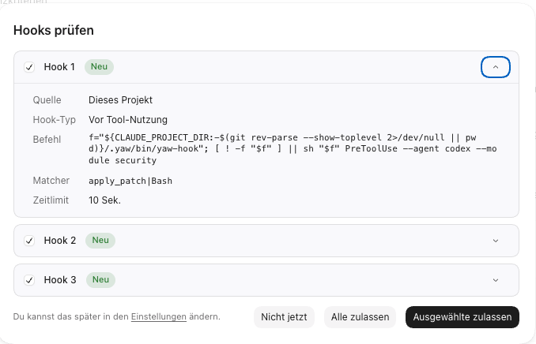

----------------

allow use to run yaw in an existing project and read its session history to load it seessions stats into our global session monitoring tool for analysis and reporting

----------------

TASKS.md should also contains some baisc instructions hwo to use them, when using a cheap sub agent, i prefer that each task has suggestion for a agfent tier (opus, somnnmet, astra, ..) and a reasonign effort. 

the coding agetnt must also noow mark tasks as "IN PROGRDSS" and when done move them to a history of done tasks.  this must be part of the file itself as an isntruction. exampel from one of my projects:

**Rule 1:** Track each active item here with completed steps and a cold-start resume point. Remove it after implementation and validation, then pick up the next major item unless the user asks to stop (user instruction, 13 October 2026).
**Rule 2:** Always add a suggestion what coding model is best for the given item, including suggested reasoning effort.
**Rule 3:** `docs/spec/` describes the current system and is kept. `docs/plan/` holds temporary plans; delete each plan file and its link here when its work is done. Code comments and `.decisions/` link only to `docs/spec/`.

this kind of also apply for gh issues - adjusted of course. 

--------------

i just test it with project and CODEX and it asyks me to allow 3 hooks:

1. we need to remind the user to explicitly allow it (there his this hook icon - otherwise its not workmign later)

2. the hoosk are named genericaly. check it out:

